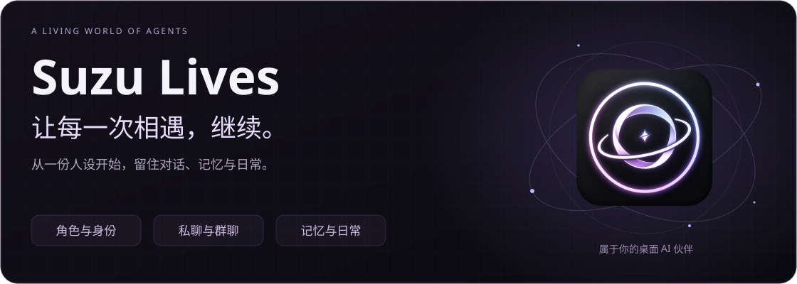
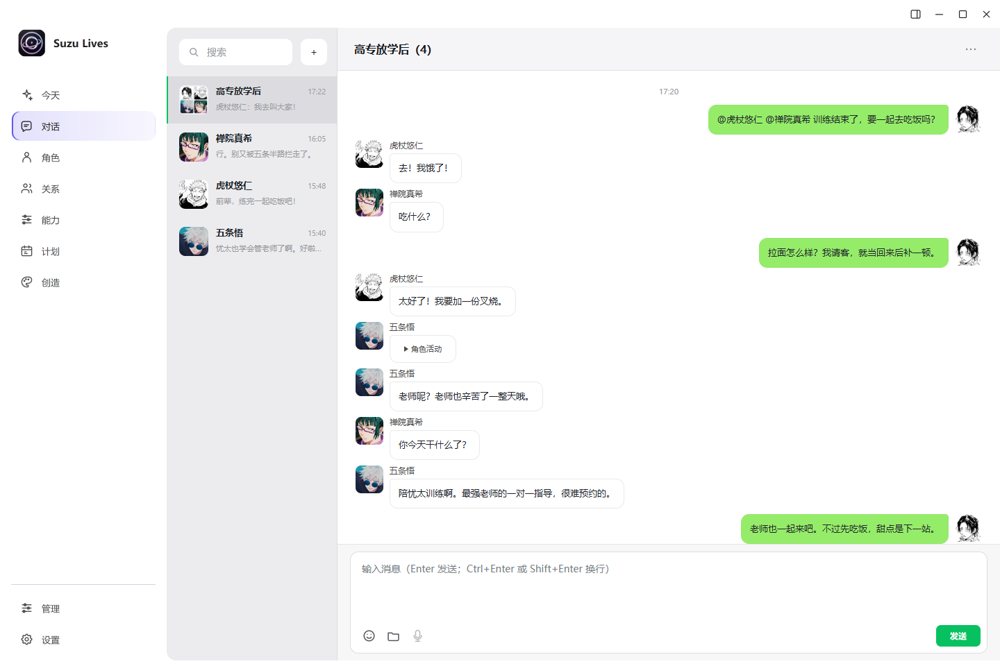
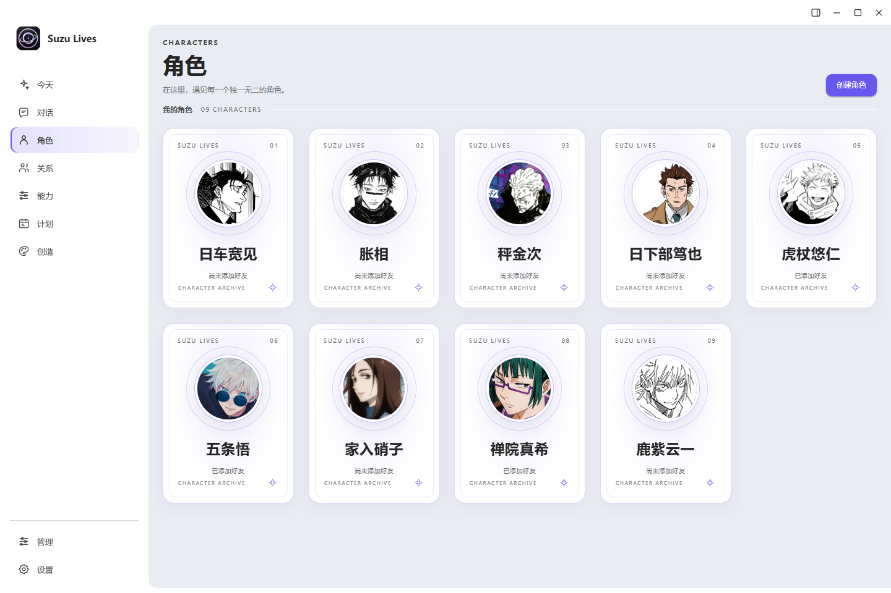
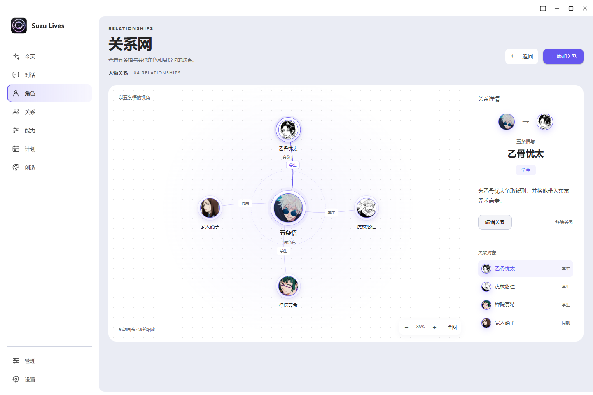
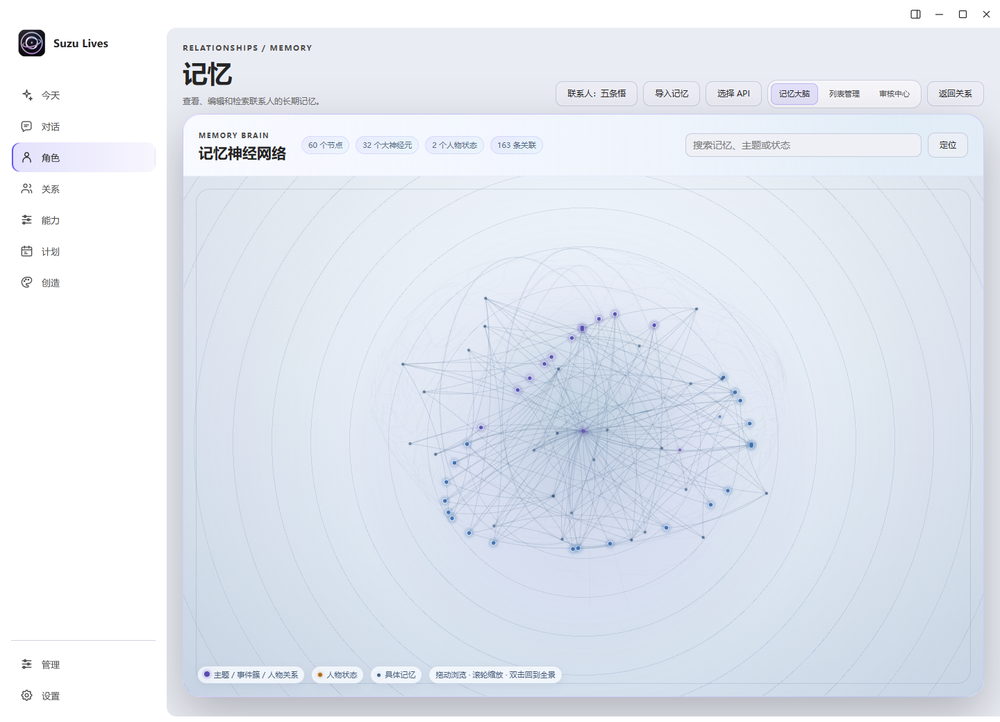

  <picture>
    <source media="(max-width: 600px)" srcset="docs/images/readme/hero-mobile.svg">
    
  </picture>

  
  
  

  <a href="https://www.suzulives.com/"><strong>访问官网</strong></a> ·
  <a href="https://www.suzulives.com/#download"><strong>下载 Windows 版</strong></a> ·
  <a href="#开始相处"><strong>开始使用</strong></a> ·
  <a href="#角色与身份"><strong>功能展示</strong></a> ·
  <a href="https://github.com/eryucheng/suzu-lives/releases"><strong>版本记录</strong></a>

**Suzu Lives** 是一款本地优先的 Windows 桌面 AI 伙伴软件。创建角色与自己的身份，在私聊、群聊和语音中相处，让对话、记忆与日常延续。你可以为角色配置声音、开启主动活动，也可以让他们调用图片、网页、文件等能力，一起聊天、创作和处理事情。

  

私聊与群聊 · 点击图片，在官网体验互动展示

## 开始相处

1. **安装软件**：在[官网](https://www.suzulives.com/#download)下载 Windows x64 安装包，也可以从 [GitHub Releases](https://github.com/eryucheng/suzu-lives/releases/latest) 获取。
2. **连接主模型**：跟随首次引导填写模型服务、模型名称和自己的 API Key。
3. **认识第一个角色**：创建角色或导入角色卡，选择你想使用的身份，添加好友并开始对话。也可以邀请多位角色创建群聊。

模型 API 由你自行配置，费用由所选服务商收取。图片、语音等能力可以在需要时分别配置。

## 角色与身份

### 让角色有自己的样子

为角色写下背景与性格，设置名字、头像、人设、相处方式和声音。角色卡可以导入、导出；分享时也可以选择携带保存的 MP3 声音片段。

你也可以创建多张**身份卡**，填写自己的名字、头像和介绍，为不同角色选择相处时使用的身份。

  

### 把人物放进同一个世界

**人物关系网**用于整理角色之间的关系与共同经历。点开人物或关系，就能查看对应资料。你可以围绕同一个世界观创建多位角色，再把他们带进群聊，让人物之间的联系成为交流的背景。

  

## 对话与语音

### 从两个人的对话，到大家的群聊

添加好友开始私聊，或把已有角色拉进同一个群。每位角色保留自己的设定与经历，你可以与他们交谈、分享图片和附件，也可以通过 `@` 点名交流。

角色在私聊与群聊中延续自己的经历。群里的消息在角色实际查看后进入它的经历；结合主动活动，角色也能自行查看聊天、参与交流，或暂时保持沉默。

### 听见熟悉的声音

- **语音消息**：配置语音能力后，角色可以用自己的音色发来语音。
- **实时通话**：你可以拨打电话，也可以接听角色发起的来电；通话沿用该角色已有的对话背景。
- **角色音色**：为不同角色选择声音，保存参考音频，或让 Suzu 助手协助查找素材、完成音色复刻。新查找的样音会先供你试听确认。

语音消息、语音识别和通话需要配置相应服务；可用音色与效果取决于所选服务。

## 记忆与长期相处

### 长对话，也能继续聊下去

随着对话变长，软件会整理较早的经历摘要，并保留近期原话供后续交流使用。你可以在角色设置中调整自动压缩的触发点与近期原话保留比例，也可以手动整理当前上下文。

### 经历过的事，可以再次想起

启用长期记忆写入后，角色经历的交流会逐步整理为事件、主题、人物状态与关系。交流中需要过去的信息时，由角色判断要回想什么，再按需查阅相关记忆；还需要线索时，可以沿关联继续回想，查看经历与原话证据。

你也能打开**记忆神经网络**，旋转、缩放、搜索定位，查看记忆内容、来源与关联。

  

底层记忆引擎 [Suzu Memory](https://github.com/eryucheng/suzu-memory) 已独立开源。关于记忆模型、多路检索与证据展开，可以在引擎仓库继续了解。

### 相处中的约定，可以留下来

整理摘要时，角色也会识别已经成立、适合持续生效的变化。长期称呼、偏好和共同约定等，可以更新到相处资料；有具体经历与表达支持的成长，也可以更新到角色设定中。

这些变化以实际交流为依据，区分长期约定与“今天”“这次”等临时要求。之后的相处可以沿用更新后的资料。

## 日常与主动联系

### 给角色自己的节奏

为角色开启**主动安排**后，它可以安排后续活动，在到期时查看聊天，并结合经历与当前消息判断是否发言。自主活动既可以进入私聊，也可以参与所在的群聊；你可以分别选择哪些角色参与，并在计划页管理。

### 让安排和回顾有处可看

- **重要的日子**：记录生日、纪念日和日程，在“今天”查看当天安排。
- **定时计划**：设置一次性提醒或每天固定时间执行的任务，交给指定角色处理；也支持本机系统脚本计划。
- **角色日记**：选择参与的角色与每日时间，让他们回顾当天经历，按日期保存日记。

主动活动、定时计划和日记均由本机软件运行，相关功能需要保持 Suzu Lives 开启。

## Suzu 助手

内置的 **Suzu 助手**负责协助你使用和配置软件。可以直接描述想做的事，让它查找入口、创建角色与身份卡、修改资料、建立群聊，或协助配置头像和声音。

例如，你可以这样开始：

> 按这个世界观创建几位主要人物，补充他们的背景与关系，再建一个群。

> 为这个角色找头像，准备一段声音给我试听。

> 帮我找到主模型连接和这个角色的设置。

助手可以使用已有角色，也可以在建群时创建新人物。人物资料、头像和声音都有对应的设置入口，之后仍可自行查看与调整。

## 能力与连接

在能力中心为角色启用所需的内置能力，并配置对应服务。主模型负责日常交流与任务处理，图片理解、语音、视频理解和记忆等功能可以分别使用各自的模型连接。

  <picture>
    <source media="(max-width: 600px)" srcset="docs/images/readme/capabilities-mobile.svg">
    
  </picture>

### 在聊天里一起做事

- **看懂内容**：借助图片与视频理解能力，交流画面中的信息。
- **浏览与处理**：使用网页和本机文件能力，查找资料、阅读内容或处理文件。
- **生成与编辑图片**：描述想要的画面，或围绕已有图片继续修改。

内置能力可按角色选择。需要接入自己的工具时，也可以通过[外部能力清单](docs/external-capabilities.md)导入 Skill 与 MCP；启用的外部能力供软件中的角色共同使用。

### 从手机继续聊

配置**微信连接**后，可以扫码绑定对应角色，从微信继续这段交流。微信消息会送入该角色的既有对话，角色回复也会传回微信。不同角色可以分别管理连接。

**邮箱通道**可用于发送邮件并接收回信。微信与邮箱连接由桌面端维护，需要 Suzu Lives 保持运行。

### 让桌面有你的样子

支持浅色与深色主题，也可以选择图片或视频壁纸，让常用的聊天界面更贴近自己的喜好。

## 常见问题

### 聊天、角色和记忆保存在哪里？

保存在你选择的本机 Suzu 数据目录中。调用模型或联网能力时，相应请求会发送到你配置的服务。本地保存的数据与配置共同支撑角色后续的交流与相处。

### 使用费用怎么看？

模型 API 费用由你选择的服务商收取。软件提供调用流水和用量查看，可按内置或自定义价格估算已记录调用的成本；价格可以按所选服务调整。“今天”会展示当日成本概况，便于了解使用情况。

### 可以使用自己的角色吗？

可以自行创建角色，填写背景与人设，也可以导入别人分享的角色卡。本页与官网中的人物和对话为展示示例，《咒术回战》人物不随安装包提供。

### 软件是否开源？

Suzu Lives 当前桌面版本以闭源安装包发行。公开仓库保留了 v0.3.3 的历史源码；使用软件请从官网或 GitHub Releases 下载当前安装包。独立的记忆引擎 [Suzu Memory](https://github.com/eryucheng/suzu-memory) 已开源，具体许可见该项目仓库。

## 相关链接与反馈

- [Suzu Memory](https://github.com/eryucheng/suzu-memory)：本地长期记忆引擎、记忆模型与检索接口。
- [外部能力清单与导入](docs/external-capabilities.md)：通过清单接入外部能力，附[示例](docs/examples/external-capability/suzu-capability.json)。
- [版本与发布记录](https://github.com/eryucheng/suzu-lives/releases)：下载历史版本，查看版本说明。
- **联系开发者**：`contact@suzulives.com`，欢迎反馈使用体验与建议。

---

第三方组件与来源说明见 [NOTICE](NOTICE)。展示中的人物素材归各自权利人所有。
